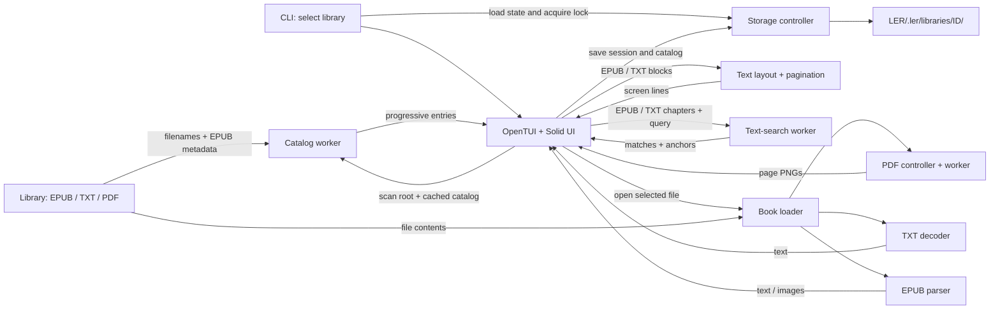
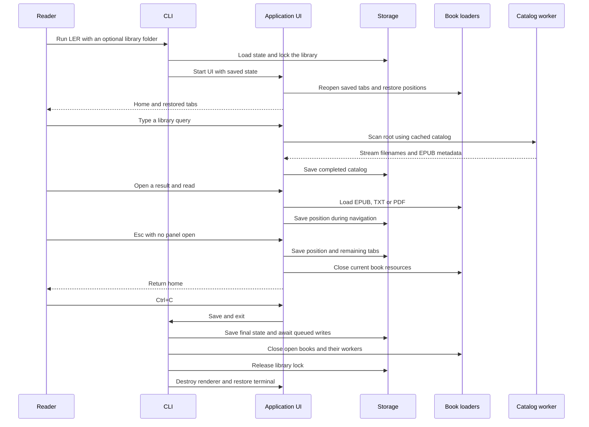

# LER — Leitor Extremamente Reduzido

A local EPUB, TXT and PDF reader for the terminal, with tabs, bookmarks and saved reading positions. EPUB and TXT use text pagination; PDF pages are displayed as images with zoom and horizontal reading bands. No account, uploads or telemetry.

[](https://github.com/SantLuiz/ler/actions/workflows/ci.yml)
[](LICENSE)

[Português (Brasil)](docs/README.pt-BR.md)

**Status:** version 0.1.0, under development, with Windows as the primary platform. Terminal graphics quality depends on your terminal; automated tests do not replace checking images in a real session.

## Install and read your first book

The recommended arrangement is one library folder containing your books and a separate `LER` subfolder containing the cloned application. You do not need to import or move books into the application.

### 1. Prepare the terminal and prerequisites

Install **Git for Windows** and either **Bun 1.4.4 or newer** or **Node.js with npm**. When Bun is absent, the installer uses npm to prepare a local Bun runtime inside the clone. Internet access is needed to clone and install dependencies; reading works offline afterward.

Use a terminal with at least **60 columns and 20 rows**. For detailed PDF pages and EPUB images, use a terminal supporting SIXEL or Kitty graphics. The blocks fallback has lower visual detail.

The main walkthrough below uses **Command Prompt (CMD)**. In Windows Terminal, open a Command Prompt tab: Windows Terminal is the terminal application, while CMD and PowerShell are different shells. PowerShell equivalents are provided below; do not paste CMD-specific syntax such as `cd /d` or `%USERPROFILE%` into PowerShell.

Check Git and your chosen runtime in a newly opened terminal:

```bat
git --version
```

For Bun, run `bun --version`. For the Node.js route, run `node --version` and `npm --version`. If a command is not found after installing it, reopen the terminal before continuing.

### 2. Create the library folders

This example uses `Documents\Biblioteca` in your Windows user profile. You can use another existing location instead; replace the paths consistently throughout the instructions.

In CMD:

```bat
mkdir "%USERPROFILE%\Documents\Biblioteca"
mkdir "%USERPROFILE%\Documents\Biblioteca\Ficcao"
mkdir "%USERPROFILE%\Documents\Biblioteca\Tecnicos"
mkdir "%USERPROFILE%\Documents\Biblioteca\Textos"
```

If a folder already exists, keep it and continue. Category folders are optional; nested folders such as `Ficcao\Autor` also work.

### 3. Add and organize your books

Using File Explorer, copy your `.epub`, `.pdf` and `.txt` files into these category folders, or keep an existing collection there. For example:

```text
Biblioteca/
├── Ficcao/
│   └── Autor/
│       └── Romance.epub
├── Tecnicos/
│   └── Manual.pdf
└── Textos/
    └── Anotacoes.txt
```

LER searches subfolders recursively. EPUB search includes filename, title and author metadata; TXT and PDF are searched by filename. Book files stay outside the cloned application folder, so they are separate from the application's Git repository.

### 4. Clone LER inside the library folder

Go to the library root and clone the repository into a new `LER` subfolder:

```bat
cd /d "%USERPROFILE%\Documents\Biblioteca"
git clone https://github.com/SantLuiz/ler.git LER
cd LER
```

The resulting layout should be:

```text
Biblioteca/                 library root: run LER from here
├── Ficcao/                 your EPUBs and other books
├── Tecnicos/               your PDFs
├── Textos/                 your TXT files
└── LER/                    cloned application, not a book folder
    ├── bin/LER.cmd
    ├── scripts/install.cmd
    ├── scripts/install.ps1
    ├── src/
    └── package.json
```

Do not put your books inside `Biblioteca\LER`: the application skips its own installation folder when browsing and indexing the library. If you already cloned LER here, reuse that clone instead of cloning again.

### 5. Install and register the command in PATH

From `Biblioteca\LER`, where `package.json` is located, run:

```bat
scripts\install.cmd
```

Wait for the success message. The installer installs dependencies and adds **`Biblioteca\LER\bin`** to the current user's PATH, allowing the `LER` command to work from other folders. You do not need to edit PATH manually or run as administrator.

Close and reopen the terminal to load the updated PATH. PATH makes the command available; it does not choose the library folder.

### 6. Start LER from the library root

In the new CMD session:

```bat
cd /d "%USERPROFILE%\Documents\Biblioteca"
LER
```

Check the **full library path in the home screen footer**. It should point to `Biblioteca`, containing your category folders, rather than a different working directory.

You can select the library explicitly from any folder:

```bat
LER "%USERPROFILE%\Documents\Biblioteca"
```

The argument is a **folder**, not an individual book file. If you run `LER` from `Biblioteca\Ficcao`, only that folder and its subfolders are searched. If you run it from inside the `LER` clone, its parent folder is used as the library.

### 7. Find a book and start reading

1. Type part of a filename in the home search. For EPUB, you can also type a title or author. Search ignores case and accents, and matches all typed words.
2. On the first non-empty query, wait for indexing to return results. An empty search does not list all books.
3. Select a result with `↑` / `↓` and press `Enter`, or click it. Alternatively, choose **Library/Folders** below the search to browse directories.
4. For EPUB/TXT, use `Page Down`, `Page Up`, arrows or `Space` to read. For PDF, use the page and zoom controls below.
5. Press `Esc` to save the current position, close the book tab and return home. If a panel or console is open, the first `Esc` dismisses it instead.
6. Choose **Resume** or type `/continue` to reopen the last reading position. `Ctrl+C` saves and exits LER.

After adding, moving or removing books, press **Ctrl+R** on home or use `/refresh` to update the catalog. The catalog is not a live filesystem watcher.

### PowerShell equivalents

If you prefer PowerShell, the setup commands are:

```powershell
New-Item -ItemType Directory -Force -Path "$env:USERPROFILE\Documents\Biblioteca\Ficcao", "$env:USERPROFILE\Documents\Biblioteca\Tecnicos", "$env:USERPROFILE\Documents\Biblioteca\Textos"
Set-Location "$env:USERPROFILE\Documents\Biblioteca"
git clone https://github.com/SantLuiz/ler.git LER
Set-Location .\LER
powershell -NoProfile -ExecutionPolicy Bypass -File .\scripts\install.ps1
```

Add your books with File Explorer as described above. After installation, close and reopen the terminal, then run:

```powershell
Set-Location "$env:USERPROFILE\Documents\Biblioteca"
LER
```

Skip the clone command if the `LER` folder already contains the repository.

## Library selection and maintenance

| Command | Purpose |
| --- | --- |
| `LER` | Use the current folder, or the clone's parent when launched inside the clone |
| `LER "D:\Books"` | Use a specific library folder |
| `LER --library "D:\Books"` | Select the same folder using an explicit option |
| `LER --choose` | Ask which folder to open |
| `LER --lang en` / `LER --lang pt-BR` | Select the interface language |
| `LER --check` | Check that the selected folder exists and report it, without opening the UI or creating reading state |
| `LER --help` / `LER --version` | Show help or version |

A previous library choice does not override the current directory. Each selected root has separate session data and preferences.

To update an existing installation, exit LER first, then run in CMD:

```bat
cd /d "%USERPROFILE%\Documents\Biblioteca\LER"
git pull --ff-only
scripts\install.cmd
```

Restart LER after updates. This uses the same clone and preserves its ignored `.ler/` reading data. Back up that folder before changing installations.

From the clone root, these PowerShell commands cover other installation choices:

```powershell
powershell -NoProfile -ExecutionPolicy Bypass -File .\scripts\install.ps1 -NoPath
powershell -NoProfile -ExecutionPolicy Bypass -File .\scripts\install.ps1 -SkipDependencies
powershell -NoProfile -ExecutionPolicy Bypass -File .\scripts\install.ps1 -Uninstall
```

Use one command as needed: `-NoPath` installs without registering the command; `-SkipDependencies` registers it after dependencies are already installed; `-Uninstall` removes only this installation's user PATH entry, preserving files and reading data. Without PATH registration, run `bin\LER.cmd` from the clone root. Before moving an installation, unregister it at the old location, then install again at the new one.

If `LER` is not found, reopen the terminal and check `where LER` in CMD or `Get-Command LER -All` in PowerShell. Multiple results may indicate several installations; update the one actually used by the command. Re-run the installer from that clone if necessary.

## Reading controls

| Key | Action |
| --- | --- |
| `↑` / `↓`, `j` / `k` | Scroll EPUB/TXT by one line |
| `←` / `→`, `Page Up` / `Page Down`, `Space` | Navigate EPUB/TXT by screens |
| `Home` / `End` | Start / end of the current text chapter |
| `F6` / `Shift+F6` | Cycle book tabs, home and settings |
| `Esc` / `F4` | Save and close the current book; `Esc` dismisses an open panel/console first |
| `F5` | Return home without closing book tabs |
| `F3` | Appearance and language settings |
| `/` | Search EPUB/TXT text; show slash commands on home |
| `n` / `Shift+N` | Next / previous text search result |
| `s` | EPUB contents, TXT section or PDF page list |
| `b` / `Shift+B` | Toggle bookmark / list bookmarks |
| `d` in bookmarks | Delete selected bookmark |
| `i` on an EPUB image | Enlarge the image |
| `F2` / `Ctrl+P` | Command palette |
| `F12` | Show / hide diagnostic console |
| `Ctrl+C` | Save and exit |

Folder navigation uses arrows and `Enter`; `Backspace` with an empty folder filter goes to the parent directory. On home, `j` and `k` are search text, not result-navigation shortcuts.

Home commands: `/library`, `/settings`, `/continue`, `/help`, `/refresh`, `/quit`. Portuguese equivalents `/biblioteca`, `/config`, `/continuar`, `/ajuda`, `/atualizar`, `/sair` also work.

## Formats and PDF controls

| Format | Reading mode | Limitations |
| --- | --- | --- |
| EPUB | Reflowable text, chapters, contents and raster images | No DRM or fixed-layout EPUB; simplified CSS, typography and emphasis; no general SVG rendering |
| TXT | Text with preserved line breaks; UTF-8, UTF-16 with BOM, Windows-1252 fallback | Empty/binary files rejected; up to 64 MiB |
| PDF | Pages rendered locally as images, including scans, tables and illustrations | No text search, selection or OCR; files requiring a password are unsupported; up to 256 MiB / 20,000 pages |

EPUB/TXT text search returns at most 1,000 matches. EPUB encryption metadata for unused resources such as embedded fonts does not block readable text; LER does not decrypt resources. Some error messages remain bilingual.

PDF rendering uses [PDFium](https://github.com/hyzyla/pdfium) in a background worker. Pages are rendered on demand, with at most two PNG pages cached per open document. No external PDF viewer is required.

| PDF key | Action |
| --- | --- |
| `Page Up` / `Page Down`, `Space` | Previous / next page; while zoomed, previous / next horizontal band (`Space` advances) |
| Arrows / `j` / `k` | Change pages at 100%; pan while zoomed |
| `+` / `-` (`=` or `i` also enlarge) | Zoom between 100% and 400% |
| `0` | Fit the whole page |
| `Home` / `End` | First / last page |
| `s` | List pages |
| `b` / `Shift+B` | Bookmark page / list bookmarks |

Zoom expands the page sideways into the available width. Taller content is read in horizontal bands with a small overlap and a band indicator in the footer. At the final band, `Page Down` advances to the next page, retaining zoom. Horizontal panning is needed only when the enlarged page also exceeds the terminal width. The mouse wheel changes pages at 100% and pans vertically while zoomed. PDF resume saves the page; zoom and band position are not persisted.

## Appearance and animation

Open **Settings** with `F3` or `/settings`. Use `↑↓` to select a row and `←→` to adjust it; press `Enter` to edit a color as `#RRGGBB`. Settings include background/text colors, text reading width, line spacing, EPUB image height, image protocol and language. Changes are saved per library. EPUB image height ranges from 30% to 100% of the reading area, with 80% as default; PDF uses its own page view.

The pixel logo has soft-blue twinkles inside and around its letters, a background starfield, and an LED strip lighting from left to right. Search and open panels pause the effects. In smaller terminals the logo becomes compact.

| Setting | Options |
| --- | --- |
| Home effects | On / Off for the logo animation, LED strip and background stars |
| Animation pixel size | Small / Medium / Large glyphs; physical size depends on terminal font and zoom |
| Pixel quantity | 25%–200%, in steps of 25%; affects logo and background |

Defaults are Medium / 100%, with up to 240 background points; 200% allows up to 480. Choices persist even with effects disabled. Font size belongs to the terminal: in Windows Terminal use `Ctrl` + `+` / `-` or `Ctrl` + mouse wheel.

## Data, backups and project folders

```text
Biblioteca/
├── Ficcao/, Tecnicos/, Textos/   your books, outside the Git clone
└── LER/
    ├── README.md                English guide
    ├── docs/README.pt-BR.md      Portuguese guide
    ├── bin/LER.cmd              PATH launcher
    ├── scripts/                 installers and Solid runtime preload
    ├── src/                     application code
    ├── tests/                   self-authored test fixtures and tests
    ├── node_modules/            dependencies, created by installation
    └── .ler/                    generated local data, ignored by Git
        ├── libraries/ID/        per-library state, bookmarks, preferences, catalog
        ├── cache/               package-manager / transpiler caches
        ├── tmp/                 temporary files
        └── legacy/              archived old profile configuration, when present
```

Back up `LER/.ler/` to preserve reading data. Per-library directories contain `state.json`, a backup, `library.json` and a lock while open. Books are identified by a content hash; reopening identical bytes after a rename can reconnect saved progress. Paths are relative to the library/installation where applicable, so moving them together preserves those references.

Legacy `.leitor/` state is migrated when opening its library; unknown files are preserved. Old profile configuration is archived in `.ler/legacy/` when present. Runtime data is local to the clone; the installer's persistent setting outside it is the user PATH entry.

Package manifests, both lockfiles, `bunfig.toml`, `tsconfig.json`, license and the main README stay at the root. CI lives in `.github/workflows/`.

## Architecture

The UI manages session state and saving. Workers return catalog entries, text-search results or PDF images; they do not directly write reading state.



### Session lifecycle



Startup normally opens the home screen; restored tabs do not force the last book onto the screen. The **Resume** action explicitly opens the last saved reading position.

## Development

With Bun installed, run from the clone root:

```sh
bun install --frozen-lockfile
bun run typecheck
bun test
bun run start
```

If using local Bun on Windows, replace `bun` with `.\node_modules\.bin\bun.cmd`. CI checks types and runs tests on Windows. `bun.lock` pins Bun installation; `package-lock.json` supports the installer's `npm ci` bootstrap. Keep both lockfiles. Use small self-authored fixtures; do not commit personal books, reading state or copyrighted passages. Graphics changes also require checking a real terminal.

## License

[MIT](LICENSE). Dependencies retain their own licenses.
