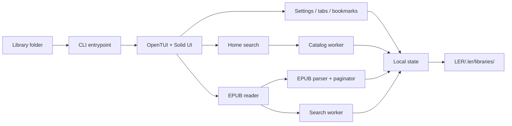
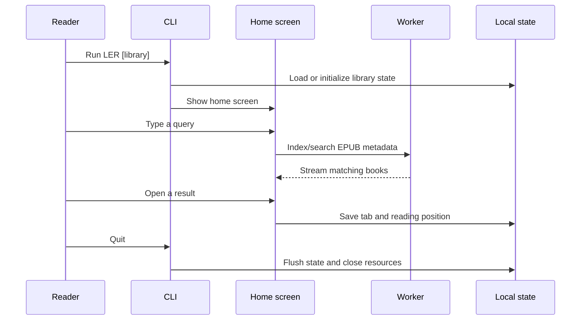

# LER — Leitor Extremamente Reduzido

> A focused EPUB, TXT and PDF reader for the terminal.

LER is a local, keyboard-first EPUB, TXT and PDF reader built with TypeScript, SolidJS and OpenTUI. It keeps the reading experience intentionally small: open a library, find a book, read with predictable pagination, and resume exactly where you stopped.

[](https://github.com/SantLuiz/ler/actions/workflows/ci.yml)
[](LICENSE)

**Status:** early development / pre-v0.1.0. The automated suite is green, but native terminal graphics still need validation in a real Windows Terminal session.

[Português (Brasil)](docs/README.pt-BR.md)

## Why LER?

Most EPUB readers are designed around a browser window. LER is for people who want a quiet, local reading workflow that stays in the terminal:

- no account, server, upload or network service;
- books remain in the folders where you keep them;
- progress, bookmarks and preferences are stored locally beside the installation;
- search works across filenames, titles and authors, then inside the open book;
- keyboard shortcuts make the common path fast, while mouse input remains available.

## Features at a glance

| Area | What LER provides |
| --- | --- |
| Library | Recursive EPUB/TXT/PDF discovery, EPUB metadata indexing and folder navigation |
| Reading | Screen paging, chapter navigation, contents, images and simplified HTML text |
| Search | Accent-insensitive library search and cancellable in-book search with up to 1,000 matches |
| Continuity | Saved position, bookmarks, open tabs and last-session resume |
| Personalization | Background/text colors, reading width, line spacing, image height and language |
| Runtime | Windows installer, user-level PATH integration, Bun-based development workflow |
| Privacy | Local-only state; no telemetry and no book uploads |

## How it fits together



The application is deliberately split into small modules: EPUB parsing and normalization live in `src/book.ts`, catalog indexing in `src/catalog.ts`, pagination in `src/pagination.ts`, persistence in `src/storage.ts`, and the terminal UI in `src/app.tsx`.

### Session lifecycle



## Installation on Windows

LER currently targets Windows because its installer and native terminal rendering are Windows-first. Install **Bun 1.4.4+** or **Node.js with npm**, then clone the repository:

```bat
cd /d D:\Library
git clone https://github.com/SantLuiz/ler.git LER
cd LER
scripts\install.cmd
```

The installer installs dependencies and adds the repository's `bin` directory to the current user's PATH. It does not require administrator access. Reopen terminals that were already running before installation.

PowerShell users can run the installer directly:

Run the following commands from the cloned repository's root, which contains `package.json`:

```powershell
powershell -NoProfile -ExecutionPolicy Bypass -File .\scripts\install.ps1
```

Useful installer switches:

```powershell
.\scripts\install.ps1 -NoPath              # install dependencies without changing PATH
.\scripts\install.ps1 -SkipDependencies   # only register the command
.\scripts\install.ps1 -Uninstall          # remove LER from the user PATH
```

`-Uninstall` removes only the PATH entry. It preserves the repository, books, progress and bookmarks.

## Running LER

Run `LER` from the folder that contains your books:

```bat
cd /d D:\Books
LER
```

You can also select a different library explicitly:

```bat
LER "D:\Other Books"
LER --choose
LER --library "D:\Other Books"
LER --lang en
LER --check
LER --help
LER --version
```

When the command is launched from inside the cloned repository, LER uses the repository's parent folder as the default library. An explicit path always wins; a remembered library location never silently overrides the current working directory.

The home screen footer shows the full absolute library path, wrapping it across lines when needed.

## First reading session

EPUB search includes titles and authors from metadata. TXT and PDF are indexed by filename. Use `Ctrl+R` after adding files to an existing library.

1. Start LER from your books folder.
2. Press `F5` or choose the LER tab to focus the home search.
3. Type part of a filename, title or author. Search is case- and accent-insensitive; every typed word must match.
4. Use `↑` / `↓` or `j` / `k`, then press `Enter` to open a book.
5. Press `Esc` to save your position and close the current book tab, returning to home. Use `Ctrl+C` to save and quit LER. The next session can resume the saved position.

The first non-empty library query builds a metadata catalog in a worker. It reads package metadata rather than every chapter, progressively shows results, and reuses the catalog for unchanged files. Press `Ctrl+R` on the home screen after changing files on disk.

## Keyboard reference

| Key | Action |
| --- | --- |
| `Enter` / `Backspace` | Open directory or book / go to the parent directory |
| `↑` `↓` or `j` `k` | Move one line |
| `←` `→`, `Page Up` / `Page Down`, `Space` | Move one screen |
| `Home` / `End` | Chapter start / chapter end |
| `F6` / `Shift+F6` | Cycle book tabs, home and settings |
| `F4` | Close the active book tab |
| `F3` | Open settings |
| `F5` | Return to home/search |
| `/` | Search inside a book; open slash commands on home |
| `n` / `Shift+N` | Next / previous in-book search result |
| `s` | Open table of contents |
| `b` / `Shift+B` | Toggle bookmark / list bookmarks |
| `d` in bookmarks | Delete the selected bookmark |
| `i` on an image | Open an enlarged image view |
| `F2` / `Ctrl+P` | Open the command palette |
| `F12` | Show / hide the diagnostic console |
| `Esc` | Dismiss the console/panel; otherwise save and close the current book tab |
| `Ctrl+C` | Save and quit |

Mouse input can select books and tabs and scroll reading content. Menus also support arrow keys and `Enter`.

## TXT and PDF

TXT supports UTF-8, UTF-16 with a byte-order mark, and Windows-1252 fallback. Line breaks are preserved. Reading, text search, bookmarks, tabs and saved position work as with EPUB; empty or binary files are rejected. The TXT size limit is 64 MiB.

PDF pages are rendered locally as images in a background worker using [PDFium](https://github.com/hyzyla/pdfium). Text, scanned pages, tables and illustrations retain their page layout. No external PDF application or OCR is required. Rendering is on demand, with at most two rendered pages cached per open document.

| PDF key | Action |
| --- | --- |
| `Page Up` / `Page Down`, `Space` | Previous / next page; while zoomed, previous / next horizontal band (`Space` advances) |
| Arrow keys / `j` / `k` | Change pages at 100%; pan while zoomed |
| `+` / `-` (or `=` / `i` to enlarge) | Zoom from 100% to 400% |
| `0` | Fit the whole page |
| `Home` / `End` | First / last page |
| `s` | List pages |
| `b` / `Shift+B` | Bookmark page / list bookmarks |
| `Esc` | Save and close the tab, or dismiss an open panel |

Zoom expands the displayed page sideways to use the available terminal width. Once the page exceeds the viewport height, it is read in horizontal bands with a small overlap. The footer shows the current band; after the last band, `Page Down` advances to the next page while retaining zoom. Horizontal panning is only needed when the enlarged page also exceeds the terminal width. `0` restores the whole-page view.

The mouse wheel changes pages at 100% and pans vertically while zoomed. PDF text search and selection are unavailable in image mode. PDFs requiring a password are reported as unsupported; the file limit is 256 MiB and 20,000 pages. Image quality depends on the terminal's graphics support; the blocks fallback is less detailed than SIXEL/Kitty.

## Commands and settings

On the home screen, type `/` to use commands:

| Command | Result |
| --- | --- |
| `/library` | Open library/folder navigation |
| `/settings` | Open appearance and language settings |
| `/continue` | Reopen the last saved reading position |
| `/help` | Show contextual help |
| `/refresh` | Refresh the library catalog |
| `/quit` | Save and exit |

Open **Settings** with `F3`, the home option or `/settings`. Changes apply immediately and persist with the selected library. The terminal controls font size; in Windows Terminal, use `Ctrl` + `+` / `-` or `Ctrl` + mouse wheel.

The home logo uses terminal pixel blocks with light lettering and tiny soft-blue stars twinkling between the letters. The letters and dotted baseline remain still. The animation stops during search and while a panel is open, and uses a compact static mark in smaller terminals. Turn **Logo animation** off in Settings for a static logo; the choice is saved per library.

## Data, backups and privacy

LER does not move or copy your books. Application-owned data is stored inside the cloned repository:

```text
LER/
├── .ler/
│   ├── libraries/<library-id>/   # progress, tabs, bookmarks, preferences, catalog
│   ├── cache/                    # package-manager and runtime caches
│   ├── tmp/                      # temporary files
│   └── legacy/                   # archived legacy configuration, when migrated
├── bin/LER.cmd                   # PATH launcher
├── src/                          # application source
├── tests/                        # automated tests
├── scripts/                      # install.cmd, install.ps1 and runtime preload
└── docs/                         # README.pt-BR.md
```

All runtime directories are gitignored and created lazily. Back up `.ler/` if you want to preserve reading data. Identical EPUB bytes retain their identity when a file is renamed; reopening a moved file can reconnect its saved progress. The first opening of an old library migrates legacy `.leitor/` data into `.ler/` and preserves unknown files.

## Development

Dependencies are pinned in `bun.lock`. With Bun installed:

```sh
bun install --frozen-lockfile
bun run typecheck
bun test
```

If Bun is not installed globally, the repository's installer can bootstrap it through npm. For a direct local run on Windows:

```powershell
.\node_modules\.bin\bun.cmd run start
```

The CI workflow runs type checking and the full test suite on Windows for every push and pull request.

`package-lock.json` is also required: the Windows installer uses `npm ci` to bootstrap Bun when it is not installed. Keep both lockfiles. Use small, self-authored test fixtures and do not commit personal books, reading data or screenshots of copyrighted passages. For rendering changes, check scrolling, resizing, tab switching and exit cleanup in a real terminal; update English and Portuguese interface text together.

## Project structure

The root contains the main README, license, package manifests, lockfiles and Bun/TypeScript configuration. Application code lives in `src/`, tests in `tests/`, Windows installers and runtime helpers in `scripts/`, the PATH launcher in `bin/`, and translated documentation in `docs/`. GitHub Actions configuration lives in `.github/workflows/`.

```text
src/
├── app.tsx               # OpenTUI/Solid application shell and interactions
├── book.ts               # EPUB reading, normalization and image resolution
├── catalog.ts            # Recursive library indexing and metadata extraction
├── catalog.worker.ts     # Background catalog worker
├── cli.ts                # Argument parsing and library selection rules
├── home.ts               # Home screen, commands and folder navigation
├── main.tsx              # Process lifecycle and renderer bootstrap
├── pagination.ts         # Visual pagination and chapter boundaries
├── preferences.ts        # Default and validated appearance settings
├── search.worker.ts      # Background in-book search
├── formats.ts            # Supported extensions and filename titles
├── text.ts               # TXT decoding and reading
├── pdf.ts                # PDF worker lifecycle and page resources
├── pdf.worker.ts         # PDF page rendering and bounded image cache
├── storage.ts            # State, backups, migration and library isolation
└── components/           # Small reusable UI components
```

## Current limitations

- EPUB 2/3 reflowable text and raster images are supported; DRM and fixed-layout books are not.
- General SVG rendering and full publisher CSS fidelity are not supported.
- Complex typography and inline emphasis are intentionally simplified.
- EPUB/TXT in-book search returns at most 1,000 matches; PDF image mode has no text search.
- SIXEL graphics and image interaction still require validation in a real compatible terminal.
- Some error messages remain bilingual while localization is being completed.

Encryption metadata for unused resources, such as embedded fonts, does not prevent reading the book. LER uses the terminal font and does not decrypt resources; encrypted chapters remain unsupported.

## License

LER is released under the [MIT License](LICENSE).
