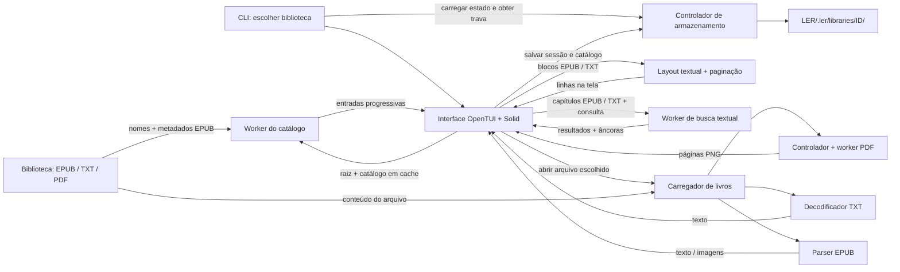
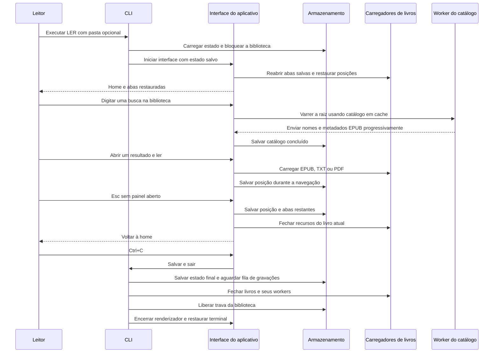

# LER — Leitor Extremamente Reduzido

Leitor local de EPUB, TXT e PDF para terminal, com abas, marcadores e retomada da leitura. EPUB e TXT são paginados como texto; PDF é exibido como imagens das páginas, com zoom e faixas horizontais de leitura. Sem conta, envio de livros ou telemetria.

[](https://github.com/SantLuiz/ler/actions/workflows/ci.yml)
[](../LICENSE)

[English](../README.md)

**Estado:** versão 0.1.0 em desenvolvimento, com prioridade para Windows. A qualidade gráfica depende do terminal; testes automatizados não substituem a conferência das imagens em uma sessão real.

## Instalar e ler seu primeiro livro

A organização recomendada é uma pasta de biblioteca contendo seus livros e uma subpasta `LER` separada, com o aplicativo clonado. Não é necessário importar os livros nem colocá-los dentro do aplicativo.

### 1. Preparar o terminal e os pré-requisitos

Instale **Git para Windows** e uma destas opções: **Bun 1.4.4 ou superior** ou **Node.js com npm**. Quando não há Bun instalado, o instalador usa npm para preparar um Bun local dentro do clone. É necessária conexão à internet para clonar e instalar as dependências; depois, a leitura funciona offline.

Use um terminal com pelo menos **60 colunas e 20 linhas**. Para visualizar PDFs e imagens de EPUB com mais detalhes, use um terminal com suporte a SIXEL ou Kitty. A alternativa em blocos tem menor definição.

O passo a passo principal abaixo usa o **Prompt de Comando (CMD)**. No Windows Terminal, abra uma aba de Prompt de Comando: Windows Terminal é o aplicativo de terminal, enquanto CMD e PowerShell são shells diferentes. Há comandos equivalentes para PowerShell mais abaixo; não cole nele comandos próprios de CMD, como `cd /d` ou `%USERPROFILE%`.

Confira o Git e o runtime escolhido em um terminal recém-aberto:

```bat
git --version
```

Se escolheu Bun, execute `bun --version`. Se escolheu Node.js, execute `node --version` e `npm --version`. Se um comando não for encontrado logo após a instalação, reabra o terminal antes de continuar.

### 2. Criar as pastas da biblioteca

O exemplo usa `Documents\Biblioteca` dentro do seu perfil do Windows. Você pode escolher outro local existente; nesse caso, substitua os caminhos de forma consistente em todo o passo a passo.

No CMD:

```bat
mkdir "%USERPROFILE%\Documents\Biblioteca"
mkdir "%USERPROFILE%\Documents\Biblioteca\Ficcao"
mkdir "%USERPROFILE%\Documents\Biblioteca\Tecnicos"
mkdir "%USERPROFILE%\Documents\Biblioteca\Textos"
```

Se uma pasta já existir, mantenha-a e prossiga. As categorias são opcionais; subpastas como `Ficcao\Autor` também funcionam.

### 3. Colocar e organizar os livros

Pelo Explorador de Arquivos, copie seus arquivos `.epub`, `.pdf` e `.txt` para as categorias ou mantenha sua coleção já existente nesse local. Por exemplo:

```text
Biblioteca/
├── Ficcao/
│   └── Autor/
│       └── Romance.epub
├── Tecnicos/
│   └── Manual.pdf
└── Textos/
    └── Anotacoes.txt
```

O LER pesquisa as subpastas recursivamente. Para EPUB, a busca considera nome do arquivo, título e autor dos metadados; TXT e PDF são pesquisados pelo nome do arquivo. Os livros ficam fora do clone do aplicativo, separados do repositório Git dele.

### 4. Clonar o LER dentro da pasta da biblioteca

Entre na raiz da biblioteca e clone o repositório em uma nova subpasta chamada `LER`:

```bat
cd /d "%USERPROFILE%\Documents\Biblioteca"
git clone https://github.com/SantLuiz/ler.git LER
cd LER
```

A estrutura resultante deve ser:

```text
Biblioteca/                 raiz da biblioteca: execute LER daqui
├── Ficcao/                 seus EPUBs e outros livros
├── Tecnicos/               seus PDFs
├── Textos/                 seus arquivos TXT
└── LER/                    aplicativo clonado, não uma pasta de livros
    ├── bin/LER.cmd
    ├── scripts/install.cmd
    ├── scripts/install.ps1
    ├── src/
    └── package.json
```

Não coloque os livros dentro de `Biblioteca\LER`: o aplicativo ignora a própria pasta de instalação na navegação e na indexação. Se você já clonou o LER nesse local, use o clone existente em vez de clonar novamente.

### 5. Instalar e registrar o comando no PATH

Dentro de `Biblioteca\LER`, onde está o arquivo `package.json`, execute:

```bat
scripts\install.cmd
```

Aguarde a mensagem de instalação concluída. O instalador prepara as dependências e adiciona **`Biblioteca\LER\bin`** ao PATH do usuário, permitindo chamar `LER` a partir de outras pastas. Não é necessário editar o PATH manualmente nem executar como administrador.

Feche e reabra o terminal para carregar o PATH atualizado. O PATH disponibiliza o comando; ele não escolhe qual pasta será usada como biblioteca.

### 6. Executar o LER a partir da raiz da biblioteca

No novo terminal CMD:

```bat
cd /d "%USERPROFILE%\Documents\Biblioteca"
LER
```

Confira o **caminho completo da biblioteca no rodapé da home**. Ele deve apontar para `Biblioteca`, que contém as categorias, e não para outro diretório de trabalho.

Também é possível informar a biblioteca explicitamente, a partir de qualquer pasta:

```bat
LER "%USERPROFILE%\Documents\Biblioteca"
```

O argumento é uma **pasta**, não o caminho de um livro individual. Se executar `LER` de dentro de `Biblioteca\Ficcao`, somente essa pasta e suas subpastas serão pesquisadas. Se executar de dentro do clone `LER`, a biblioteca usada será a pasta pai dele.

### 7. Encontrar um livro e começar a ler

1. Digite parte do nome do arquivo na busca da home. Para EPUB, também é possível buscar pelo título ou autor. A pesquisa ignora maiúsculas e acentos e combina todas as palavras digitadas.
2. Na primeira busca não vazia, aguarde os resultados da indexação. Uma busca vazia não lista todos os livros.
3. Selecione um resultado com `↑` / `↓` e pressione `Enter`, ou clique nele. Como alternativa, escolha **Biblioteca** abaixo da busca para navegar pelas pastas.
4. Em EPUB/TXT, use `Page Down`, `Page Up`, setas ou `Espaço` para ler. Em PDF, use os controles de páginas e zoom descritos abaixo.
5. Pressione `Esc` para salvar a posição, fechar a aba do livro e voltar à home. Se houver painel ou console aberto, o primeiro `Esc` fecha apenas esse painel.
6. Escolha **Continuar** ou digite `/continuar` para retomar a última leitura. `Ctrl+C` salva e encerra o LER.

Depois de adicionar, mover ou remover livros, pressione **Ctrl+R** na home ou use `/atualizar` para atualizar o catálogo. O catálogo não monitora alterações do sistema de arquivos continuamente.

### Equivalentes no PowerShell

Se preferir PowerShell, os comandos de preparação são:

```powershell
New-Item -ItemType Directory -Force -Path "$env:USERPROFILE\Documents\Biblioteca\Ficcao", "$env:USERPROFILE\Documents\Biblioteca\Tecnicos", "$env:USERPROFILE\Documents\Biblioteca\Textos"
Set-Location "$env:USERPROFILE\Documents\Biblioteca"
git clone https://github.com/SantLuiz/ler.git LER
Set-Location .\LER
powershell -NoProfile -ExecutionPolicy Bypass -File .\scripts\install.ps1
```

Adicione os livros pelo Explorador de Arquivos conforme explicado acima. Após instalar, feche e reabra o terminal e execute:

```powershell
Set-Location "$env:USERPROFILE\Documents\Biblioteca"
LER
```

Pule o comando de clonagem se a pasta `LER` já contiver o repositório.

## Escolha da biblioteca e manutenção

| Comando | Finalidade |
| --- | --- |
| `LER` | Usar a pasta atual, ou a pasta pai do clone quando iniciado dentro dele |
| `LER "D:\Livros"` | Usar uma pasta específica como biblioteca |
| `LER --library "D:\Livros"` | Selecionar a mesma pasta por uma opção explícita |
| `LER --choose` | Perguntar qual pasta abrir |
| `LER --lang pt-BR` / `LER --lang en` | Selecionar o idioma da interface |
| `LER --check` | Verificar se a pasta selecionada existe e informá-la, sem abrir a interface nem criar estado de leitura |
| `LER --help` / `LER --version` | Mostrar ajuda ou versão |

Uma biblioteca escolhida anteriormente não substitui o diretório atual. Cada raiz selecionada tem dados de sessão e preferências separados.

Para atualizar uma instalação existente, saia do LER primeiro e execute no CMD:

```bat
cd /d "%USERPROFILE%\Documents\Biblioteca\LER"
git pull --ff-only
scripts\install.cmd
```

Reinicie o LER depois de atualizar. Esse procedimento usa o mesmo clone e preserva os dados de leitura em `.ler/`, ignorados pelo Git. Faça backup dessa pasta antes de trocar de instalação.

Na raiz do clone, estes comandos de PowerShell atendem a outras opções de instalação:

```powershell
powershell -NoProfile -ExecutionPolicy Bypass -File .\scripts\install.ps1 -NoPath
powershell -NoProfile -ExecutionPolicy Bypass -File .\scripts\install.ps1 -SkipDependencies
powershell -NoProfile -ExecutionPolicy Bypass -File .\scripts\install.ps1 -Uninstall
```

Use um dos comandos conforme a necessidade: `-NoPath` instala sem registrar o comando; `-SkipDependencies` registra depois que as dependências já estiverem instaladas; `-Uninstall` remove apenas a entrada dessa instalação no PATH do usuário, preservando arquivos e leituras. Sem registrar no PATH, execute `bin\LER.cmd` a partir da raiz do clone. Antes de mover a instalação, remova o registro no local antigo e instale novamente no novo.

Se `LER` não for encontrado, reabra o terminal e confira `where LER` no CMD ou `Get-Command LER -All` no PowerShell. Vários resultados podem indicar várias instalações; atualize aquela usada pelo comando. Se necessário, execute novamente o instalador a partir desse clone.

## Controles de leitura

| Tecla | Ação |
| --- | --- |
| `↑` / `↓`, `j` / `k` | Rolar uma linha em EPUB/TXT |
| `←` / `→`, `Page Up` / `Page Down`, `Espaço` | Navegar por telas em EPUB/TXT |
| `Home` / `End` | Início / fim do capítulo de texto atual |
| `F6` / `Shift+F6` | Alternar entre abas de livros, home e configurações |
| `Esc` / `F4` | Salvar e fechar o livro atual; `Esc` fecha primeiro um painel/console aberto |
| `F5` | Voltar à home sem fechar as abas de livros |
| `F3` | Aparência e idioma |
| `/` | Buscar texto em EPUB/TXT; mostrar comandos na home |
| `n` / `Shift+N` | Próximo / anterior resultado da busca textual |
| `s` | Sumário do EPUB, seção do TXT ou lista de páginas do PDF |
| `b` / `Shift+B` | Alternar marcador / listar marcadores |
| `d` nos marcadores | Excluir o marcador selecionado |
| `i` sobre uma imagem do EPUB | Ampliar a imagem |
| `F2` / `Ctrl+P` | Paleta de comandos |
| `F12` | Abrir / fechar o console de diagnóstico |
| `Ctrl+C` | Salvar e sair |

A navegação por pastas usa setas e `Enter`; `Backspace` com o filtro vazio volta à pasta anterior. Na home, `j` e `k` são texto da busca, não atalhos para selecionar resultados.

Comandos da home: `/biblioteca`, `/config`, `/continuar`, `/ajuda`, `/atualizar`, `/sair`. Os equivalentes em inglês `/library`, `/settings`, `/continue`, `/help`, `/refresh`, `/quit` também funcionam.

## Formatos e controles de PDF

| Formato | Modo de leitura | Limitações |
| --- | --- | --- |
| EPUB | Texto fluido, capítulos, sumário e imagens raster | Sem DRM ou EPUB de layout fixo; CSS, tipografia e ênfase simplificados; sem renderização geral de SVG |
| TXT | Texto com quebras de linha preservadas; UTF-8, UTF-16 com BOM e Windows-1252 como alternativa | Arquivos vazios/binários recusados; até 64 MiB |
| PDF | Páginas renderizadas localmente como imagens, incluindo digitalizações, tabelas e ilustrações | Sem busca, seleção de texto ou OCR; arquivos que exigem senha não são suportados; até 256 MiB / 20 mil páginas |

A busca textual em EPUB/TXT retorna até mil resultados. Metadados de criptografia em recursos não usados do EPUB, como fontes embutidas, não bloqueiam o texto legível; o LER não descriptografa recursos. Alguns erros ainda são bilíngues.

PDF usa [PDFium](https://github.com/hyzyla/pdfium) em um worker em segundo plano. As páginas são renderizadas sob demanda, com até duas páginas PNG em cache por documento aberto. Não é necessário um visualizador externo de PDF.

| Tecla no PDF | Ação |
| --- | --- |
| `Page Up` / `Page Down`, `Espaço` | Página anterior / próxima; com zoom, faixa horizontal anterior / próxima (`Espaço` avança) |
| Setas / `j` / `k` | Trocar páginas em 100%; deslocar a área visível com zoom |
| `+` / `-` (`=` ou `i` também ampliam) | Ajustar zoom entre 100% e 400% |
| `0` | Mostrar a página inteira |
| `Home` / `End` | Primeira / última página |
| `s` | Listar páginas |
| `b` / `Shift+B` | Marcar página / listar marcadores |

O zoom aumenta a largura ocupada pela página. Conteúdo mais alto é lido em faixas horizontais com pequena sobreposição e indicador da faixa no rodapé. Na última faixa, `Page Down` avança para a página seguinte mantendo o zoom. O deslocamento horizontal só é necessário quando a página ampliada também ultrapassa a largura do terminal. A roda do mouse troca páginas em 100% e desloca verticalmente a área ampliada. A retomada de PDF salva a página; zoom e posição na faixa não são persistidos.

## Aparência e animação

Abra **Configurações** com `F3` ou `/config`. Use `↑↓` para selecionar uma linha e `←→` para ajustar; pressione `Enter` para editar uma cor como `#RRGGBB`. As opções incluem fundo/texto, largura de leitura do texto, espaçamento, altura de imagens do EPUB, protocolo gráfico e idioma. As alterações ficam salvas por biblioteca. A altura de imagens do EPUB varia de 30% a 100% da área de leitura, com padrão de 80%; PDF usa sua própria visualização de página.

A logo pixelada tem pontos azuis cintilando dentro e ao redor das letras, um campo de estrelas ao fundo e uma fita de LED que acende da esquerda para a direita. A busca e os painéis abertos pausam os efeitos. Em terminais menores, a logo fica compacta.

| Configuração | Opções |
| --- | --- |
| Efeitos da home | Ligados / Desligados para animação da logo, fita de LED e estrelas ao fundo |
| Tamanho dos pixels | Pequeno / Médio / Grande; o tamanho físico depende da fonte e do zoom do terminal |
| Quantidade de pixels | 25%–200%, em passos de 25%; afeta a logo e o fundo |

O padrão é Médio / 100%, com até 240 pontos ao fundo; em 200%, o limite sobe para 480. As escolhas são preservadas mesmo com os efeitos desligados. O tamanho da fonte pertence ao terminal: no Windows Terminal, use `Ctrl` + `+` / `-` ou `Ctrl` + roda do mouse.

## Dados, backups e pastas do projeto

```text
Biblioteca/
├── Ficcao/, Tecnicos/, Textos/   seus livros, fora do clone Git
└── LER/
    ├── README.md                guia em inglês
    ├── docs/README.pt-BR.md      guia em português
    ├── bin/LER.cmd              comando registrado no PATH
    ├── scripts/                 instaladores e preload do Solid
    ├── src/                     código do aplicativo
    ├── tests/                   testes e fixtures de autoria própria
    ├── node_modules/            dependências criadas na instalação
    └── .ler/                    dados locais gerados, ignorados pelo Git
        ├── libraries/ID/        estado, marcadores, preferências e catálogo
        ├── cache/               caches dos gerenciadores e transpiler
        ├── tmp/                 arquivos temporários
        └── legacy/              configuração antiga do perfil, quando houver
```

Faça backup de `LER/.ler/` para preservar as leituras. Cada diretório de biblioteca contém `state.json`, backup, `library.json` e uma trava enquanto estiver aberto. Os livros são identificados por hash do conteúdo; reabrir os mesmos bytes após renomear pode reconectar o progresso salvo. Os caminhos são relativos à biblioteca/instalação quando aplicável; mover ambas juntas preserva essas referências.

O estado antigo de `.leitor/` é migrado ao abrir sua biblioteca; arquivos desconhecidos são preservados. A configuração antiga do perfil é arquivada em `.ler/legacy/`, quando presente. Os dados de execução ficam dentro do clone; a configuração persistente externa feita pelo instalador é a entrada no PATH do usuário.

Manifestos, os dois lockfiles, `bunfig.toml`, `tsconfig.json`, licença e README principal ficam na raiz. A integração contínua fica em `.github/workflows/`.

## Arquitetura

A interface gerencia a sessão e o salvamento. Os workers retornam entradas do catálogo, resultados de busca textual ou imagens do PDF; não gravam o estado de leitura diretamente.



### Ciclo da sessão



A inicialização normalmente mostra a home; restaurar as abas não força a exibição do último livro. A ação **Continuar** abre explicitamente a última posição salva.

## Desenvolvimento

Com Bun instalado, execute na raiz do clone:

```sh
bun install --frozen-lockfile
bun run typecheck
bun test
bun run start
```

Com Bun local no Windows, substitua `bun` por `.\node_modules\.bin\bun.cmd`. A integração contínua verifica tipos e testes no Windows. `bun.lock` fixa a instalação com Bun; `package-lock.json` permite ao instalador preparar o ambiente via `npm ci`. Mantenha ambos. Use fixtures pequenas e próprias; não inclua livros pessoais, estado de leitura ou trechos protegidos nos commits. Alterações gráficas também exigem conferência em terminal real.

## Licença

[MIT](../LICENSE). As dependências mantêm suas próprias licenças.
